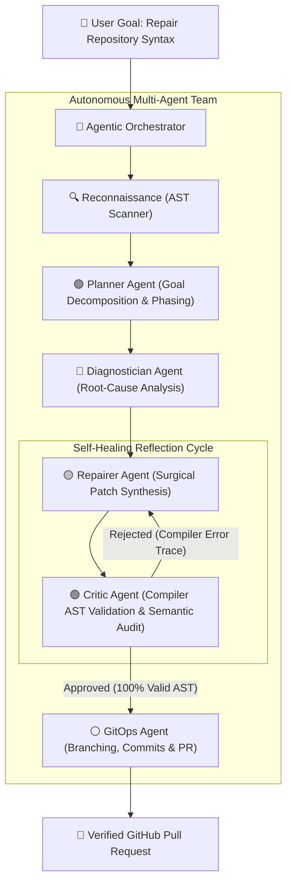

# 🧠 SyntaxFixer Agentic AI: Autonomous Multi-Agent Syntax Repair for GitHub Repositories

**SyntaxFixer** is an **Agentic AI** cognitive system—not just a single prompt-wrapper or reactive AI agent. It implements an autonomous multi-agent cognitive architecture featuring **goal-directed planning, root-cause diagnosis, surgical code synthesis, adversarial compiler auditing (critic), and GitOps execution**.

---

## 💡 What Makes It "Agentic AI" (vs a Simple AI Agent)?

| Simple AI Agent | SyntaxFixer **Agentic AI** System |
| :--- | :--- |
| Single prompt-in, code-out | **Collaborating Multi-Agent Team** (Planner, Diagnostician, Repairer, Critic, GitOps) |
| Linear, blind execution | **Dynamic Phased Planning & Dependency Ordering** |
| Assumes LLM output is correct | **Adversarial Compiler / AST Critic Audit Gate** (0 compiler errors required) |
| Fails on cascading errors | **Root-Cause Diagnosis** (separates trigger errors from cascade parse faults) |
| One-shot attempt | **Self-Healing Reflection Loop** with compiler traces fed back across iterations |
| Manual Git / PR steps | **Autonomous GitOps Agent** (branching, staging, conventional commits, GitHub PRs) |

---

## 🏛️ Multi-Agent Cognitive Architecture



### The 5 Specialized Agents:
1. **🟣 Planner Agent**: Analyzes repository structure, categorizes manifests (JSON/YAML) vs core libraries (Python/JS), and constructs a phased dependency plan.
2. **🔵 Diagnostician Agent**: Dissects raw parser traces and isolates primary trigger errors (e.g. unclosed parenthesis on line 5) from secondary cascade errors (e.g. indentation error on line 6).
3. **🟡 Repairer Agent**: Synthesizes surgical code patches strictly preserving business logic, comments, and style conventions.
4. **🟢 Critic Agent**: Serves as the strict compiler gatekeeper. Re-runs deterministic AST parsers (`ast.parse`, `node --check`, etc.) and semantic integrity checks. Rejects invalid code with detailed reflection critique.
5. **⚪ GitOps Agent**: Manages git branching (`fix/syntax-repairs-<timestamp>`), stages verified files, crafts semantic commit messages, and opens GitHub Pull Requests.

---

## 🚀 Quick Start Guide

### 1. Installation

Clone or navigate to the repository and install the dependencies:

```bash
# Clone repository
git clone https://github.com/your-username/syntax-agent.git
cd "AI AGENT"

# Install in editable mode
pip install -e .
```

### 2. Configure Environment (Optional)

Create a `.env` file from the provided `.env.example`:

```bash
cp .env.example .env
```

Add your preferred API key:
```env
SYNTAX_AGENT_PROVIDER=gemini
GEMINI_API_KEY=your_gemini_api_key_here

# For GitHub PR creation:
GITHUB_TOKEN=your_github_token_here
```

---

## 💻 CLI Usage

### Run the Full Agentic AI Multi-Agent Workflow
```bash
# Execute autonomous multi-agent cognitive architecture
syntax-agent agentic tests/fixtures --provider gemini

# Agentic dry-run previewing multi-agent collaboration dialogue
syntax-agent agentic tests/fixtures --provider heuristic --dry-run

# Autonomous end-to-end fix with dedicated branch and GitHub PR
syntax-agent agentic https://github.com/my-org/broken-repo \
  --goal "Diagnose, repair and open release PR for all syntax errors" \
  --provider gemini \
  --branch \
  --commit \
  --pr \
  --github-token ghp_yourPersonalAccessToken
```

### Direct Scan & Fix Mode
```bash
# Scan repository for syntax anomalies
syntax-agent scan tests/fixtures

# Standard reflection repair mode
syntax-agent fix tests/fixtures --provider gemini

# Preview proposed fixes without modifying files (Dry Run)
syntax-agent fix tests/fixtures --provider heuristic --dry-run

# Repair and export a git patch
syntax-agent fix . --patch syntax_fixes.patch

# Repair remote GitHub repo, commit to a branch, and open a Pull Request
syntax-agent fix https://github.com/my-org/broken-repo \
  --provider gemini \
  --branch \
  --commit \
  --pr \
  --github-token ghp_yourPersonalAccessToken
```

---

## 🌐 Interactive Web Dashboard

Launch the web interface locally with a single command:

```bash
syntax-agent ui --port 8000
```

Open your browser to: **`http://localhost:8000`**

### Features of the Web Dashboard:
1. **Target Selector**: Enter any local path or remote GitHub URL (`owner/repo`).
2. **Provider Selector**: Switch between Gemini, OpenAI, Ollama, or Heuristic.
3. **Interactive File Cards**: Shows language badge, line:column, and compiler message.
4. **Agent Reflection Terminal**: Watch the compiler AST validation loop execute live.
5. **Diff Viewer**: Side-by-side and unified colorized diff showing exact repairs.
6. **One-Click Actions**: "Fix This File", "Fix All", and "Create GitHub PR".

---

## 🤖 GitHub Actions CI/CD Integration

To automatically detect and fix syntax errors on every Pull Request in your GitHub repository, copy the workflow from `templates/syntax-agent.yml` to `.github/workflows/syntax-agent.yml`:

```yaml
name: "SyntaxFixer AI Check"

on:
  pull_request:
    branches: [ main, master ]

jobs:
  syntax-guardian:
    runs-on: ubuntu-latest
    steps:
      - uses: actions/checkout@v4
      - uses: actions/setup-python@v5
        with:
          python-version: "3.11"
      - uses: actions/setup-node@v4
        with:
          node-version: "20"
      - name: Install SyntaxFixer
        run: pip install git+https://github.com/your-username/syntax-agent.git
      - name: Verify Syntax
        run: syntax-agent scan .
```

---

## 🧪 Running the Test Suite

SyntaxFixer AI includes comprehensive test fixtures and unit tests verifying AST detectors, reflection loops, and Git operations:

```bash
pytest -v
```

All 19 tests run and pass in ~1.4 seconds.

---

## 📄 License
MIT License. Created for autonomous developer toolchains.
